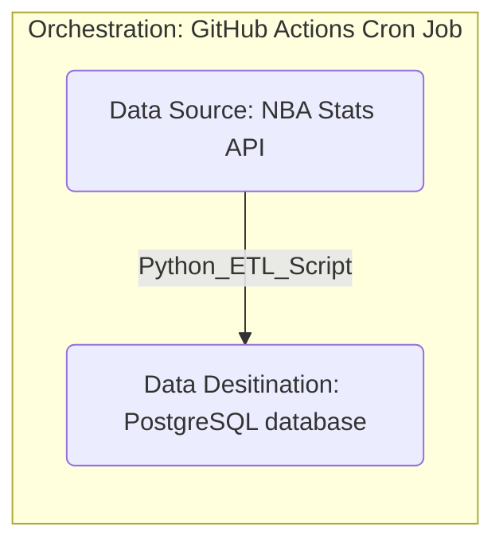

# NBA GameBoard Dashboard

## Dashboard
- Get context into upcoming NBA games including
    - NBA teams' over performance
    - previous games of the same matchup
    - NBA Reporter summary of other news (injury reports, etc.)

## Data Pipeline

## References
- NBA Stats API [Link](https://github.com/swar/nba_api)
    - An API client package to easily access the APIs of NBA.com
